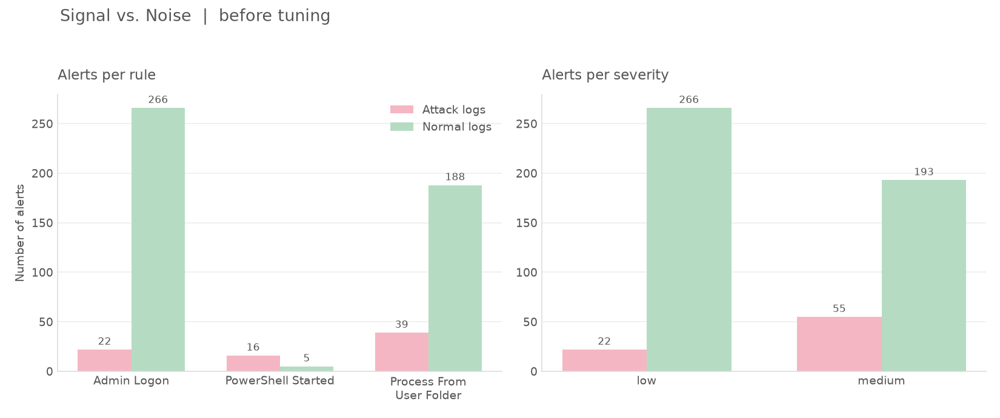
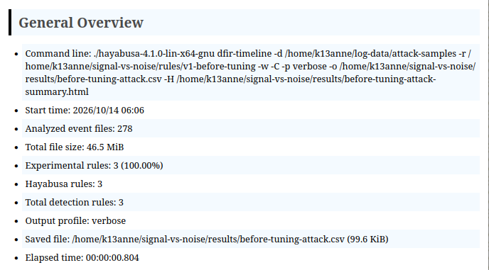
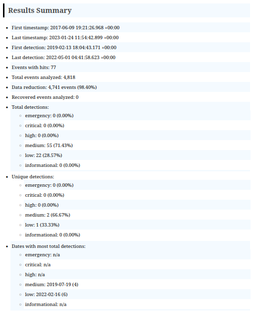
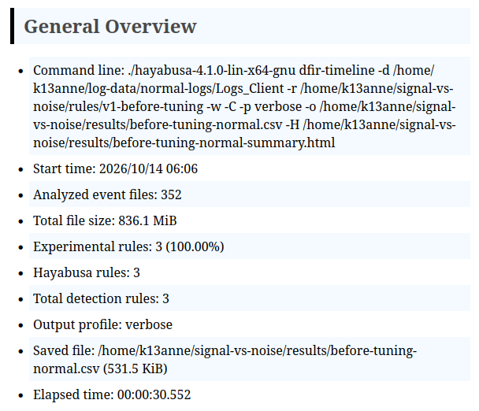
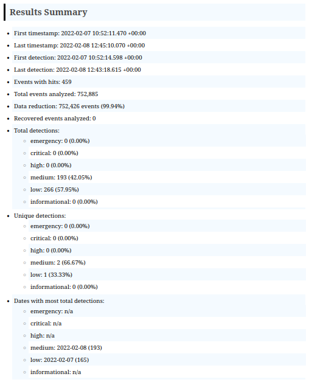
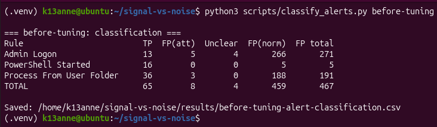

# Week 2 Results: Before Tuning

## What I did
- Chose my logs: attack logs from EVTX-ATTACK-SAMPLES, normal logs from evtx-baseline (Logs_Client folder). The sources are in logs/SOURCES.md.
- Wrote 3 first-version rules in rules/v1-before-tuning. They are broad on purpose.
- Ran Hayabusa with only my 3 rules on both sets of logs and saved the results in the results folder.
- Checked each alert on the attack logs and decided if it was a true positive, a false positive, or unclear.
- Made a first chart with a Python script.

## My 3 rules (version 1)
| Rule | What it looks for | Log used |
|---|---|---|
| PowerShell Started | Any PowerShell process start | Sysmon event 1 |
| Admin Logon | Any logon that gets special privileges | Security event 4672 |
| Process From User Folder | A program started from Temp, AppData, Users\Public, or ProgramData | Sysmon event 1 |

My first plan for rule 2 was "many failed logins". But both log sets have only 1 failed login (event 4625), so I could not test it. I used admin logons instead.

## How I ran it
```
./hayabusa-4.1.0-lin-x64-gnu dfir-timeline -d <log folder> -r rules/v1-before-tuning -w -C -p verbose -o results/<file>.csv
```
Hayabusa only read the log files my rules need: 243 of the 278 attack files, and 2 of the 352 normal files.

## Results before tuning
| Rule | Alerts on attack logs | Alerts on normal logs |
|---|---|---|
| Admin Logon | 22 | 266 |
| PowerShell Started | 16 | 5 |
| Process From User Folder | 39 | 188 |
| **Total** | **77** | **459** |

By severity: low had 22 attack and 266 normal alerts. Medium had 55 attack and 193 normal alerts.



Hayabusa summary pages:






## Alert classification
Every alert on the normal logs counts as a false positive, because those logs come from clean systems. For the attack logs, I looked at each alert (the sample name and the details) and decided myself. The full table is in results/before-tuning-alert-classification.csv.

| Rule | True positives | False positives (attack logs) | Unclear | False positives (normal logs) | False positives total |
|---|---|---|---|---|---|
| Admin Logon | 13 | 5 | 4 | 266 | 271 |
| PowerShell Started | 16 | 0 | 0 | 5 | 5 |
| Process From User Folder | 36 | 3 | 0 | 188 | 191 |
| **Total** | **65** | **8** | **4** | **459** | **467** |

Only about 1 out of 8 alerts (65 of 536) is a real detection.



## What I noticed
- Admin Logon and Process From User Folder make most of the noise.
- The false positives for Admin Logon on the attack logs were machine accounts (the name ends with $), which are normal background activity.
- The false positives for Process From User Folder were OneDrive programs, which run from the user folder.
- PowerShell Started is quiet on the normal logs (5 alerts). But only about 6 of its 16 attack alerts had a clear warning sign like a hidden window or a download command. If I tune this rule too much, I might lose real detections.
- An alert on an attack log is not always the attack itself. Some are just normal activity that was recorded during the test.

## Problems I had
- The normal logs were not in the repo I cloned. I had to download a 592 MB file, which unpacked to 8.2 GB.
- My first chart showed only the low severity. Hayabusa writes "med" in the file and my script looked for "medium". I fixed the script.
- The VM restarted a few times, probably because of low memory.
- I had to change rule 2, because failed logins could not be tested.

## Limits
- The normal logs come from one or two machines over about two days, so my results only describe these logs.
- I count all alerts on the normal logs as false positives.
- I labeled the attack alerts myself, so some labels could be wrong. Four are marked unclear.
