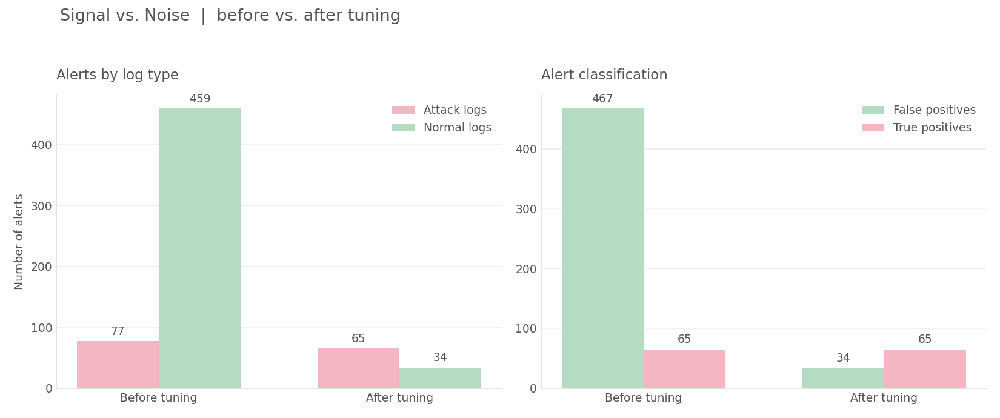

# Week 3 Findings: After Tuning

## What I did
- Checked why my 3 rules triggered false alarms on the normal logs.
- Looked at the accounts, programs, and folders that caused the alerts.
- Tested different tuning ideas before changing the rules.
- Made a second version of my 3 rules in rules/v2-after-tuning.
- Ran Hayabusa again on the same attack and normal logs.
- Compared the before-tuning and after-tuning results.
- Checked which attack alerts were removed and which ones stayed.
- Made a before-and-after comparison chart.
- Investigated one attack sample and made a simple timeline.

## Why the false alarms happened

### Admin Logon
This rule had 266 alerts on the normal logs.

Most came from system and service accounts, like SYSTEM, DWM, and other built-in accounts.

The rule was too broad because it alerted on every special-privilege logon, even when it was normal system activity.

### PowerShell Started
This rule had 5 alerts on the normal logs.

They came from normal software like Dropbox, VS Code, and Office Setup32.

These programs sometimes start PowerShell as part of their normal work, but my first rule still detected them.

### Process From User Folder
This rule had 188 alerts on the normal logs.

Many came from normal installers and updaters, like Ninite, SetUserFTA, OneDrive, and Spotify.

The first rule detected programs running from user-writable folders, even when they were legitimate.

## My 3 rules (version 2)

I updated the rule conditions based on the false-positive patterns I found.

| Rule | What I changed |
|---|---|
| Admin Logon | Excluded common system and service account SIDs |
| PowerShell Started | Excluded PowerShell started by selected normal software |
| Process From User Folder | Excluded selected installer and updater paths and parent processes |

I kept the original rules in rules/v1-before-tuning so I could compare both versions.

## How I tested the rules

I used the same log sets from Week 2:
- Attack logs: EVTX-ATTACK-SAMPLES (278 files)
- Normal logs: evtx-baseline (352 files)

I used Hayabusa 4.1.0 with only my 3 updated rules.

The results were saved in:
- results/after-tuning-attack.csv
- results/after-tuning-normal.csv

I also used Python scripts to count and classify the alerts.

## Results before and after tuning

| Rule | Attack before | Attack after | Normal before | Normal after |
|---|---:|---:|---:|---:|
| Admin Logon | 22 | 13 | 266 | 12 |
| PowerShell Started | 16 | 16 | 5 | 0 |
| Process From User Folder | 39 | 36 | 188 | 22 |
| **Total** | **77** | **65** | **459** | **34** |

## Alert classification

I checked the attack alerts to see if the tuned rules removed any previously identified true positives.

| Result | Before | After |
|---|---:|---:|
| True positives | 65 | 65 |
| False positives | 467 | 34 |
| Unclear | 4 | 0 |

The false positives decreased by 92.7%, from 467 to 34.

I also compared the individual attack events before and after tuning.

The 12 removed attack alerts were:
- 8 false positives
- 4 unclear alerts
- 0 true positives

All 65 previously identified true-positive events were still detected.

This means the tuned rules reduced false alarms without losing the original true positives in my test logs.

## Attack timeline

I investigated one attack sample called PanacheSysmon_vs_AtomicRedTeam01.evtx.

The updated rules detected 4 events:
- PowerShell started through cmd.exe
- A PowerShell command tried to get credentials
- A program ran from a temporary folder with a decode command
- PowerShell started again

The events happened on July 19, 2019.

I saved the full timeline in week3-attack-timeline.md.

## Problems I had
- Some tuning ideas could remove real detections, so I tested them before changing the rules.
- The first Hayabusa commands did not work because I used the wrong executable name.
- Some CSV columns were missing because I did not use the verbose output profile at first.
- My Python script could not read the after-tuning files until I fixed the CSV output.
- The PowerShell rule IDs were different in v1 and v2, which caused a problem when matching the alerts.
- I compared the individual events again to make sure no original true positives were lost.

## What I noticed
- Admin Logon caused most of the false alarms because of system accounts.
- Normal installers and updaters caused many User Folder alerts.
- Small changes to the rule conditions made a big difference in the number of alerts.
- It is important to test the rules on both normal and attack logs.
- Reducing false positives is useful, but I also need to check if real detections are still being caught.

## Limits
- I only tested the rules on the selected EVTX datasets.
- I still count all alerts on the normal logs as false positives because they came from clean systems.
- I classified the attack alerts myself, so some labels might not be perfect.
- Some filtered programs or accounts could still be used in real attacks.
- The results do not mean that the rules can detect every possible attack.

## Conclusion

The first version of my rules generated too many false alarms.

After checking the causes and updating the rule conditions, the false positives decreased from 467 to 34, which is a 92.7% reduction.

All 65 previously identified true positives were still detected in the test logs.

The updated rules produced fewer unnecessary alerts and made the results easier to review.
